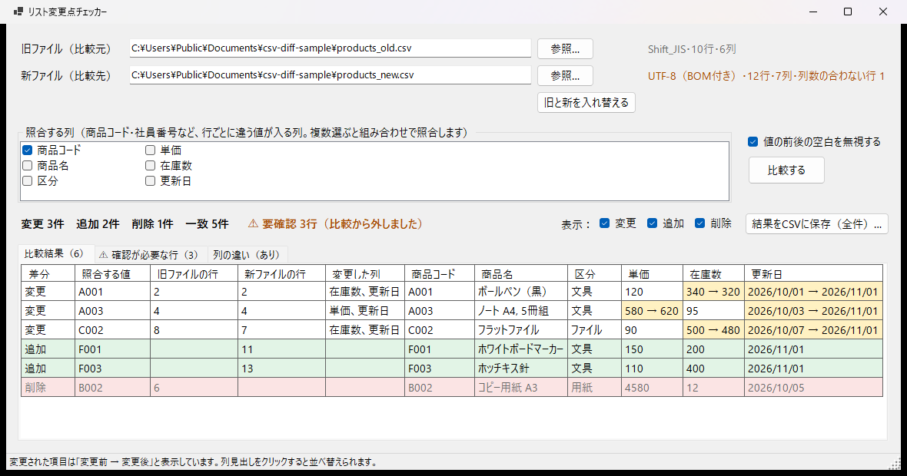
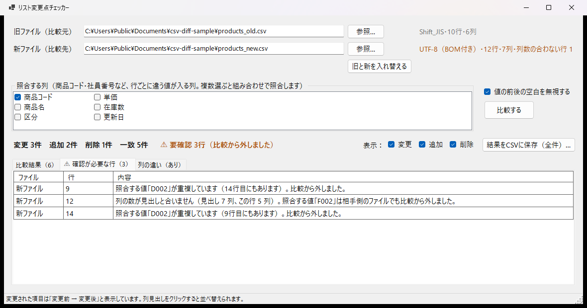
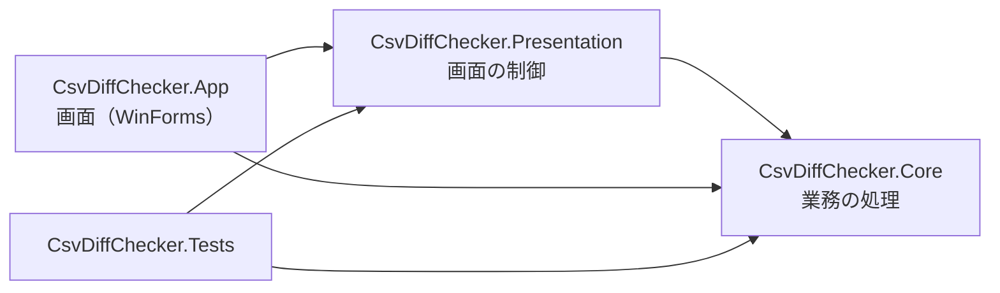

<!--
ファイル名: README.md
バージョン: 1.2.2
作成日: 2026-11-19
変更履歴:
  - 2026-11-19 v1.0.0 初版
  - 2026-11-19 v1.1.0 名称を「リスト変更点チェッカー」に変更し、冒頭と用語を業務の言葉（照合する列など）に書き直し
  - 2026-11-19 v1.2.0 画面と処理を分ける構成（MVP）に作り直したことに合わせ、構成を更新し、設計書の一覧を追加
  - 2026-11-19 v1.2.1 査読の反映に合わせ、構成・テスト件数・ビルド手順を更新
  - 2026-11-19 v1.2.2 GitHub での公開に合わせ、CI のバッジと検査範囲の注記を追加
-->
# リスト変更点チェッカー（C# / WinForms）

[](https://github.com/takato-y/csv-diff-checker/actions/workflows/build.yml)

- GitHub Actions で検査している範囲：自動テスト（xUnit）、テスト仕様書の一覧が最新であること、配布用 EXE の作成（Windows の実行環境）
- 手元の環境でのみ確認した範囲：EXE を起動しての画面の見た目（[テスト仕様書](docs/04_テスト仕様書.md) の「画面で確かめたこと」）

**先月の商品リストと今月の商品リストのように、2つのリストを比べて「何が増えて、何がなくなり、どこが変わったか」を一覧にする Windows アプリです。**

目で見比べると見落としやすい変更点を、ファイルを2つ選ぶだけで洗い出します。

本リポジトリはポートフォリオ（閲覧用）です。無断での再利用・再配布はご遠慮ください。

## 概要

| これまで | このアプリを使った後 |
|---|---|
| 2つのリストを並べて、1行ずつ目で見比べる | 増えた行・なくなった行・変わった行が、色分けされた一覧で表示される |
| どの項目がどう変わったかを、メモを取りながら確認する | 変わった項目は「変更前 → 変更後」で表示される |
| 並び順が違うと、見比べるだけで手間がかかる | 商品コードや社員番号で照合するため、並び順が違っても正しく比べられる |
| 確認した結果を、別の表に手で書き写す | 結果をそのまま Excel で開けるファイルに保存できる |

扱えるのは、業務システムや Excel から書き出した CSV ファイル（項目をカンマで区切ったテキスト形式のファイル）です。



## 想定する業務の場面

| 場面 | 確認したいこと |
|------|----------------|
| 商品マスタ・顧客マスタの更新 | 先月版と今月版で、どの商品の単価・在庫が変わったか |
| システム移行・データ取込 | 移行前のデータと移行後に出力したデータが一致しているか |
| 取引先から届くデータの受け入れ | 前回分から何が追加・削除されたか |

目で見比べると見落としやすく、Excel の関数で突き合わせると準備に手間がかかる作業を、ファイルを2つ選ぶだけで済ませます。

## 主な機能

- **照合する列の指定**：商品コード・社員番号など、行ごとに違う値が入る列で行どうしを照合する。1列でも、複数列の組み合わせ（例：店舗＋商品）でも指定できる
- **文字コードの自動判定**：Shift_JIS／UTF-8（BOM の有無）／UTF-16（BOM付き）を判定して読む。旧ファイルが Shift_JIS、新ファイルが UTF-8 のような組み合わせもそのまま比べられる。どの文字コードとしても読めないファイルは、文字化けしたまま比較せずに止める
- **変更箇所の表示**：変更されたセルは黄色で「変更前 → 変更後」、追加は緑、削除は赤で表示。種類ごとの絞り込みと列ごとの並べ替えができる
- **比較できない行の一覧**：照合する値の重複、照合する値が空の行、列の数が見出しと合わない行を、旧・新どちらのファイルの何行目かを付けて「確認が必要な行」に出す。誤った結果を出さないよう、こうした行は比較から外す（相手側のファイルの同じ値の行も外し、「追加」「削除」と誤って出さない）
- **列の違いの表示**：片方のファイルにしかない列を一覧にする（その列は比較しない）
- **結果の保存**：Excel でそのまま開ける CSV（UTF-8・BOM付き）で、表示の絞り込みに関係なく全件を保存する。確認が必要な行がある場合は、同じ場所に「（ファイル名）_要確認.csv」も保存する
- **ドラッグ＆ドロップ**：ファイルを画面に落とすだけで指定できる。2つまとめて落とした場合は、どちらを旧・新にしたかを表示する。逆だったときは「旧と新を入れ替える」で直せる
- **設定を変えたら結果を消す**：照合する列や空白の設定を変えると前の結果を消し、比較し直すよう表示する（前の設定の結果を取り違えないため）



## 安全への配慮

- **元のファイルは変更しない**：読み込みは読み取り専用。Excel で開いたままのファイルも読める
- **入力ファイルを結果で上書きしない**：比較元・比較先と同じファイルへの保存は受け付けない。既存のファイルへの上書きは確認してから行う
- **保存の失敗でファイルを壊さない**：一時ファイルに書いてから置き換えるため、途中で失敗しても中途半端なファイルが残らない
- **数式の無害化**：`=`・`+`・`-`・`@` で始まる値は、表計算ソフトで開いたときに数式として動かないよう先頭に `'` を付けて保存する（`-100` のような数値はそのまま）

## 動作環境

- Windows（64bit）
- [.NET 10 Desktop Runtime](https://dotnet.microsoft.com/download/dotnet/10.0)（x64）

EXE には .NET の実行環境を含めていません。実行環境を PC 側に入れておく配布方法にすると、.NET のセキュリティ修正が PC 側の更新で取り込まれ、修正のたびに EXE を作り直さずに済むためです。

## 使い方

1. `CsvDiffChecker.exe` を起動する
2. 「旧ファイル（比較元）」と「新ファイル（比較先）」を選ぶ（参照ボタン、またはドラッグ＆ドロップ）
3. 「照合する列」で、商品コードなど行ごとに違う値が入る列にチェックを入れる（最初の列が自動で選ばれる）
4. 「比較する」を押す
5. 必要に応じて「結果をCSVに保存（全件）…」で保存する

### サンプルで試す

[samples](samples/) に架空の商品マスタ（旧：Shift_JIS、新：UTF-8）があります。照合する列を「商品コード」にして比べると、次の結果になります。

| 結果 | 件数 | 内容 |
|------|------|------|
| 変更 | 3件 | A001（在庫数・更新日）、A003（単価・更新日）、C002（在庫数・更新日） |
| 追加 | 2件 | F001、F003 |
| 削除 | 1件 | B002 |
| 一致 | 5件 | C001 は商品名の末尾に空白があるが、「値の前後の空白を無視する」が有効なため一致 |
| 確認が必要な行 | 3件 | 新ファイルで D002 が重複（2行）、F002 は列の数が不足 |

この結果は自動テスト（`SampleFilesTests`）でも確かめています。

### 起動引数（任意）

```
CsvDiffChecker.exe --old 旧ファイル.csv --new 新ファイル.csv --key 商品コード
```

ファイルを読み込んだ状態で起動し、照合する列（`--key`）を指定した場合はそのまま比較します。照合する列はカンマ区切りで複数指定できます。

## 構成

画面・画面の制御・業務の処理の3層に分けています（MVP：Model-View-Presenter）。



```
CsvDiffChecker.slnx        ソリューション（4つのプロジェクトの一覧）
Directory.Build.props      全プロジェクト共通の設定
src/
  CsvDiffChecker.Core/           業務の処理（画面に依存しない）
    Abstractions.cs                部品の約束（ICsvTableLoader・IDiffEngine・IDiffResultWriter）
    CsvTableLoader.cs              ファイルを読み、文字コードを判定して表にする
    CsvDiffEngine.cs               照合する列で突き合わせ、差分を求める
    DiffCsvWriter.cs               結果の CSV 出力（一時ファイルに書いてから置き換える）
    CsvParser.cs・EncodingDetector.cs・CsvText.cs・DiffTableFormat.cs   状態を持たない関数
    CsvTable.cs・DiffModels.cs     データ
  CsvDiffChecker.Presentation/   画面の制御（WinForms に依存しない）
    IMainView.cs                   Presenter が画面に求める表示と問い合わせ
    MainPresenter.cs               操作の流れ・処理中の排他・ボタンの可否の判断
    ResultTable.cs                 画面にそのまま表示できる結果の表のデータ
    ComparisonState.cs             画面の状態
    StartupOptions.cs              起動引数の解釈
  CsvDiffChecker.App/            画面（WinForms）
    MainForm.cs                    IMainView の実装（渡された表示をそのまま出し、操作を Presenter に渡すだけ）
    Program.cs                     部品の組み立て
tests/
  CsvDiffChecker.Tests/          自動テスト（xUnit）。Presentation/ に偽の画面を使った画面の流れのテスト
docs/                    設計書
samples/                 架空のサンプルデータ
scripts/                 配布用 EXE の作成・テスト仕様書の一覧の作り直し
```

画面は `IMainView` 越しにだけ扱うため、偽の画面を渡して、画面を操作せずに画面の操作の流れ（ボタンの可否・処理中の排他・保存の守り）まで自動テストで確かめられます。

## 設計書

| 文書 | 内容 |
|---|---|
| [01 要件定義](docs/01_要件定義.md) | 目的・対象の業務、機能要件 REQ-001〜010、非機能要件 REQ-011〜015、対象外 |
| [02 基本設計](docs/02_基本設計.md) | 3層の構成、クラス図、責任の分担、機能一覧 FN-001〜005、画面 SCR-001、操作の可否、処理の流れ、要件と機能の対応 |
| [03 詳細設計](docs/03_詳細設計.md) | エラー一覧 ERR-001〜009、機能ごとの入出力と処理、状態と排他、保存の手順 |
| [04 テスト仕様書](docs/04_テスト仕様書.md) | テストケースの一覧（テストコードから生成）、画面で確かめたこと、要件とテストの対応 |
| [ADR](docs/adr/) | 主要な設計判断の記録（4件） |

## 設計上の判断

| 判断 | 理由 |
|------|------|
| 行番号ではなく照合する列（キー）で突き合わせる | 並べ替えや途中の行の追加があると、行番号で比べた結果は以降すべてずれるため |
| 照合する値が重複した行は比較から外して一覧に出す | どの行どうしを比べるべきか決められず、推測で突き合わせると誤った「変更」を出すため |
| 照合する値は常に前後の空白を除いて突き合わせる | 「A001」と「A001 」を別の商品として扱うと、追加と削除が1件ずつ誤って表示されるため |
| 大文字と小文字は区別する | 商品コードなどで大文字・小文字に意味がある場合に、違いを見落とさないため |
| 文字コードは UTF-8 として正しく読めるかで判定する | Shift_JIS の日本語は UTF-8 としては不正なバイト列になることが多く、誤判定が起きにくいため |
| 列の数が合わない行は、相手側の同じ値の行も比較から外す | 片側だけ外すと、相手側の行が「削除」や「追加」と誤って表示されるため |
| 改行コード（CRLF・LF）の違いは比較で無視する | 画面上では見分けられず、移行前後の確認で誤って「変更」と判定されやすいため |

## ビルドとテスト

.NET 10 SDK が必要です。

```powershell
# ビルド（画面のプロジェクトを含む全体）
dotnet build CsvDiffChecker.slnx -c Release

# テスト（テストのプロジェクトが参照する Core・Presentation だけがビルドされる）
dotnet test CsvDiffChecker.slnx -c Release

# 配布用 EXE の作成（テストに合格した場合だけ publish\CsvDiffChecker.exe を作る）
.\scripts\publish.ps1
```

自動テストは 85 ケース（データ違いの実行を含めて 95 件）で、CSV の読み取り（引用符・改行・空行・閉じていない引用符）、文字コードの判定（Shift_JIS・UTF-8・UTF-16・判定できないファイル）、差分の判定（複数列での照合・照合する値の重複・列の数が合わない行・空白と改行コードの扱い・列の違い）、CSV 出力（数式の無害化・引用符の付け方・保存・確認が必要な行）、画面の操作の流れ（ボタンの可否・処理中の排他・設定の変更・入れ替え・保存の守り・画面のスレッドの約束）を対象にしています。テストを足したら `python3 scripts/update_test_spec.py` でテスト仕様書の一覧を作り直します。
