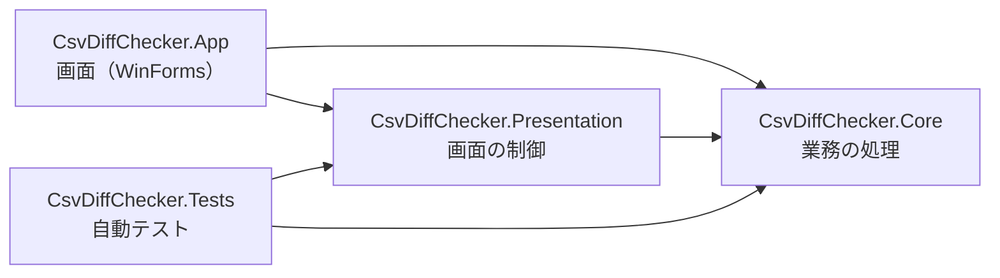
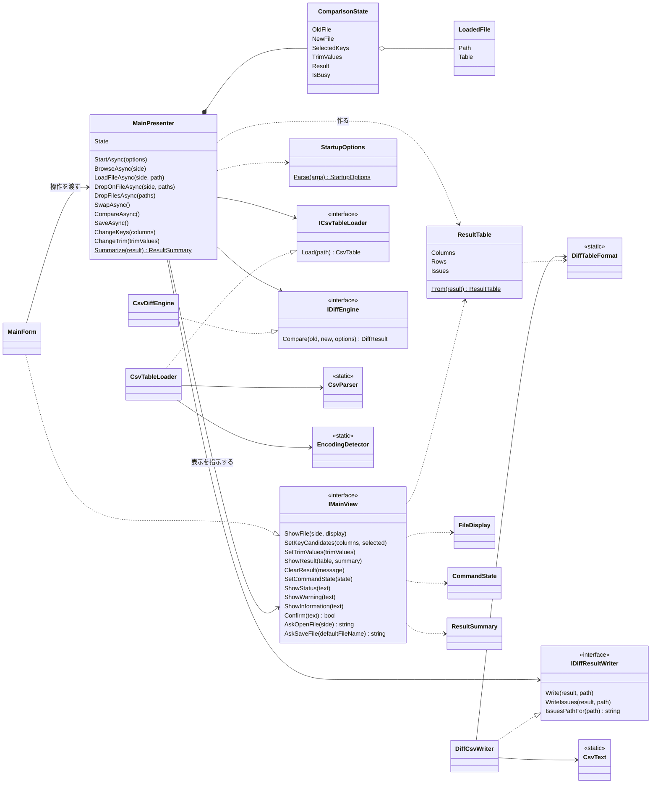
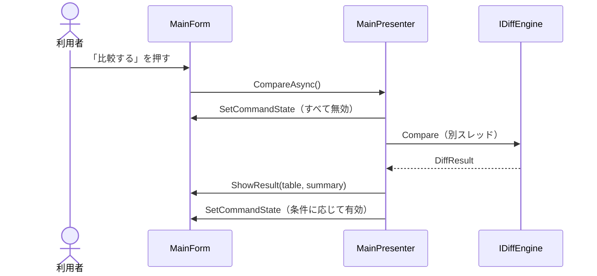

# 基本設計書

## 文書情報

| 項目 | 内容 |
|---|---|
| 文書名 | 基本設計書 |
| 文書ID | BD-001 |
| システム名 | リスト変更点チェッカー |
| 版 | 1.1 |
| 作成日 | 2026-11-19 |
| 状態 | 承認済 |

## 改版履歴

| 版 | 日付 | 変更内容 |
|---|---|---|
| 1.0 | 2026-11-19 | 新規作成 |
| 1.1 | 2026-11-19 | 査読の反映：画面に渡す表のデータ（ResultTable）を Presenter 側で作る形に変更、状態の書き換えを内部に限定、入れ替えをメモリ上の交換に変更、クラス図と排他の入口・スレッドの約束を実装に合わせる |

## 1. 設計の方針

- 画面・画面の制御・業務の処理の3層に分ける。各層は下の層だけを参照する（2.1 の例外を除く）
- 画面の制御は MVP（Model-View-Presenter）の形にする。画面（View）は表示と操作の受け渡しだけを行い、判断は Presenter が行う
- Presenter は画面をインターフェース（`IMainView`）越しにだけ扱う。偽の画面を渡して自動テストできるようにする（REQ-015）
- 業務の処理のうち、ファイルの読み書きを伴う部品はインターフェースで分け、差し替えられるようにする
- 状態を持たず入力から出力が決まる処理（CSV の読み取り・文字コードの判定・CSV の1行の作成・結果の表の形）は、静的な関数のまま残す（[ADR-0002](adr/0002-静的な関数を残す範囲.md)）

## 2. 構成

### 2.1 プロジェクトと依存関係

| プロジェクト | 種類 | 受け持つこと | 参照するもの |
|---|---|---|---|
| `CsvDiffChecker.Core` | クラスライブラリ（net10.0） | CSV の読み込み、差分の判定、結果の保存。画面に依存しない | なし |
| `CsvDiffChecker.Presentation` | クラスライブラリ（net10.0） | 画面の状態と操作の流れ、処理中の排他。WinForms に依存しない | Core |
| `CsvDiffChecker.App` | Windows アプリ（net10.0-windows） | 画面の表示と操作の受け渡し。部品の組み立て（Program） | Presentation・Core |
| `CsvDiffChecker.Tests` | テスト（xUnit） | Core と Presentation の自動テスト | Presentation・Core |

App から Core への参照は、次の2つに限る（隣の層を飛ばす例外）。処理の呼び出しは Presenter を通し、結果の表は Presenter が作ったデータ（`ResultTable`）を表示する。

- `Program`：部品（`CsvTableLoader` など）を作って Presenter に渡す（部品の組み立て）
- `MainForm`：旧・新の区別（`FileSide`）だけを使う

### 2.2 クラス図

`FileDisplay`（ファイル欄の表示）・`CommandState`（操作の可否）・`ResultSummary`（結果の要約の文）・`ResultTable`（結果の表）は、Presenter から画面へ渡すデータである。

### 2.3 責任の分担

| クラス | 層 | 責任 | 持たない責任 |
|---|---|---|---|
| `MainForm` | 画面 | 部品の配置、表示、利用者の操作を Presenter へ渡す。表の絞り込み・並べ替え・色付けなどの見た目 | 状態の保持、処理の可否の判断、ファイルの有無の判定、結果の表の組み立て、ファイルの読み書き |
| `IMainView` | 画面の制御 | Presenter が画面に求める表示と問い合わせの約束 | — |
| `MainPresenter` | 画面の制御 | 操作の受け付け、処理の順序、処理中の排他、ボタンの有効・無効の判断、保存の守り（入力ファイルへの上書きの防止など）、エラーの伝え方 | 部品の配置、CSV の解析、差分の計算、CSV の書き出し |
| `ResultTable` | 画面の制御 | 比較結果を、画面にそのまま表示できる表（見出し・型つきのセル・変更の印）にする | 表の見た目 |
| `ComparisonState` | 画面の制御 | 読み込んだファイル、選んだ照合する列、比較結果、処理中かどうか。値の書き換えは Presentation の内部に限る | 状態の変え方の判断（Presenter が行う） |
| `StartupOptions` | 画面の制御 | 起動時の引数の解釈 | — |
| `ICsvTableLoader`／`CsvTableLoader` | 業務の処理 | ファイルを読み、文字コードを判定し、見出しつきの表にする | 比較 |
| `IDiffEngine`／`CsvDiffEngine` | 業務の処理 | 照合する列で突き合わせ、追加・削除・変更・一致と確認が必要な行を求める | ファイルの読み書き |
| `IDiffResultWriter`／`DiffCsvWriter` | 業務の処理 | 結果と確認が必要な行の CSV 出力、確認が必要な行の保存先の名前、数式の無害化、安全な保存 | 保存してよいかの判断（Presenter が行う。[ADR-0004](adr/0004-保存の決まりをPresenterに置く.md)） |
| `CsvParser`・`EncodingDetector`・`CsvText`・`DiffTableFormat` | 業務の処理 | CSV の文字列の分解、文字コードの判定、CSV の1行の作成と無害化、結果の表の列の並び（状態を持たない関数） | — |
| `CsvTable`・`DiffResult` ほか | 業務の処理 | 読み込んだ表と比較結果を表すデータ | — |

## 3. 機能一覧

| 機能ID | 機能名 | 主なクラス | 概要 |
|---|---|---|---|
| FN-001 | ファイルの読み込み | `CsvTableLoader`・`EncodingDetector`・`CsvParser`・`CsvTable` | 文字コードを判定して CSV を読み、列の数が合わない行を記録する |
| FN-002 | 差分の判定 | `CsvDiffEngine` | 照合する列で突き合わせ、結果と確認が必要な行を求める |
| FN-003 | 結果の保存 | `DiffCsvWriter` | 比較結果と確認が必要な行を CSV に書き出す |
| FN-004 | 画面の操作の制御 | `MainPresenter`・`ComparisonState` | 読み込み・入れ替え・比較・保存・設定の変更を、排他しながら順に処理する |
| FN-005 | 起動引数の解釈 | `StartupOptions` | `--old`・`--new`・`--key` を読む |

## 4. 画面

### SCR-001 メイン画面

1つの画面ですべての操作を行う。実装は `MainForm` である。

| 領域 | 項目 | 内容 |
|---|---|---|
| ファイルの指定 | 「旧ファイル（比較元）」「新ファイル（比較先）」 | パスの表示（読み取り専用）、「参照…」ボタン、文字コード・行数・列数の表示。欄へのドロップを受け付ける |
| ファイルの指定 | 「旧と新を入れ替える」ボタン | 2つのファイルを入れ替える |
| 設定 | 「照合する列」 | 両方のファイルにある列を一覧にし、チェックで選ぶ |
| 設定 | 「値の前後の空白を無視する」 | 比較で値の前後の空白を無視する |
| 設定 | 「比較する」ボタン | 比較を実行する |
| 結果 | 件数 | 変更・追加・削除・一致の件数と、確認が必要な行の件数 |
| 結果 | 「表示」の絞り込み | 変更・追加・削除の表示を切り替える |
| 結果 | 「結果をCSVに保存（全件）…」ボタン | 結果を保存する |
| 結果 | タブ | 「比較結果」「確認が必要な行」「列の違い」 |
| 状態 | ステータス欄 | 操作の案内と結果の知らせ |

ボタンの有効・無効は Presenter が決める（4.1）。

### 4.1 操作の可否

| 操作 | できる条件（すべて満たす） |
|---|---|
| ファイルの指定・入れ替え・設定の変更 | 処理中でない |
| 入れ替え | 処理中でない。どちらかのファイルが指定されている |
| 比較 | 処理中でない。両方のファイルを読み込んでいる。照合する列を1つ以上選んでいる |
| 保存 | 処理中でない。比較結果があり、差分か確認が必要な行が1件以上ある |

## 5. 処理の流れ

### 5.1 比較

### 5.2 処理中の排他とスレッド

- 起動・参照（ダイアログを含む）・読み込み・ファイル欄へのドロップ・画面へのドロップ・入れ替え・比較・保存は、Presenter の1つの排他の入口（`RunExclusiveAsync`）を通す
- 処理中に別の操作が届いた場合は何もしない。照合する列・空白の設定の変更が届いた場合は、画面の表示を状態に戻す
- 処理中は画面の入力・ドロップ・ボタンをすべて無効にする（REQ-008）
- Presenter の公開メソッドと `IMainView` は、画面のスレッド（UI スレッド）から呼ぶ。重い処理だけを別スレッドで実行し、await の後は UI スレッドに戻って画面を更新する。このため Presenter の await に `ConfigureAwait(false)` を付けない（テストでは単一スレッドの同期コンテキストの上で確かめる）

## 6. 要件と機能の対応

| 要件ID | 機能 |
|---|---|
| REQ-001 | FN-004、SCR-001 |
| REQ-002 | FN-001 |
| REQ-003 | FN-002、FN-004 |
| REQ-004 | FN-002、SCR-001 |
| REQ-005 | FN-002 |
| REQ-006 | FN-002、SCR-001 |
| REQ-007 | FN-003、FN-004 |
| REQ-008 | FN-004 |
| REQ-009 | FN-004 |
| REQ-010 | FN-005、FN-004 |
| REQ-011 | FN-001、FN-003、FN-004 |
| REQ-012 | FN-003 |
| REQ-013 | FN-004 |
| REQ-014 | SCR-001 |
| REQ-015 | FN-004 |
