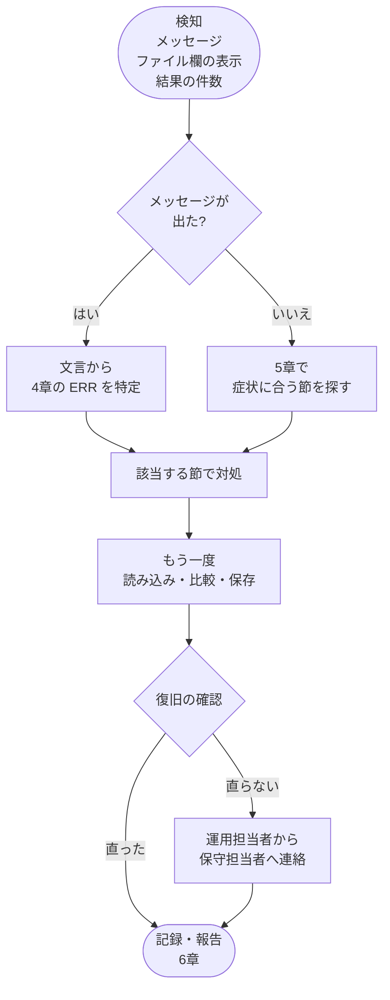

# リスト変更点チェッカー 障害対応手順書

## 文書情報

| 項目 | 内容 |
|---|---|
| 文書名 | 障害対応手順書 |
| 文書ID | OP-INC-001 |
| システム名 | リスト変更点チェッカー |
| 版 | 1.1 |
| 作成日 | 2026-11-19 |
| 状態 | 承認済 |

## 改版履歴

| 版 | 日付 | 変更内容 |
|---|---|---|
| 1.0 | 2026-11-19 | 新規作成 |
| 1.1 | 2026-11-20 | 5.4 に対応していない文字コードが別の文字コードと判定される場合を追記、ERR-008 の上書きの確認の条件を明記 |

## 1. 目的と対象

### 1.1 目的

エラーのメッセージが出た場合や、結果が想定と違う場合に、原因を切り分けて復旧するための手順を示す。

### 1.2 使う人と使う場面

| 使う人 | 場面 |
|---|---|
| 利用者 | メッセージが出たとき、4章で対処できるかを確かめる |
| 運用担当者 | 利用者から連絡を受けたとき、3章の順に切り分ける |
| 保守担当者 | 4章・5章で直らないとき、原因を調べる |

### 1.3 対象範囲

詳細設計書 1章のエラー（ERR-001〜ERR-009）と、エラーIDの付かない症状（5章）を対象とする。
このツールはネットワークに接続せず、データを持たない。障害の影響は、利用者が見ている結果と保存したファイルに限られる。

## 2. 障害時の基本の流れ



## 3. 切り分けの順番

このツールはログファイルを作らない。手がかりは次の4か所だけであるため、上から順に確認する。

| 順 | 確認する場所 | 見ること | 次に進む先 |
|---|---|---|---|
| 1 | 表示されたメッセージ | 文言。閉じる前に控える | 4章の該当する節 |
| 2 | ファイル欄の右の表示 | 「読み込めませんでした」（赤）か、文字コード・行数・列数か。「列数の合わない行」の件数 | 赤 → ERR-001〜ERR-004。件数あり → 「確認が必要な行」タブ |
| 3 | 件数の欄と「確認が必要な行」タブ | 変更・追加・削除・一致の件数、要確認の行数と内容 | 件数が想定と違う → 5.3・5.4 |
| 4 | 画面下のステータス欄 | 直前の操作の結果（保存先など） | 保存の確認 → ERR-006〜ERR-008 |

## 4. エラー別の対応手順

各節の文言は、コードが表示する文言をそのまま示す。「…」は実行時にファイル名・行番号・理由などが入る部分を表す。

### `ERR-001` ファイルを開けない

| 項目 | 内容 |
|---|---|
| 事象 | 「旧ファイルを読み込めませんでした。」（または「新ファイルを…」）に続けて理由と「ファイルの場所と、開く権限があるかを確認してください。」が出る。ファイル欄の右に赤字で「読み込めませんでした」と出る |
| 影響 | その側は未読み込みに戻る。前の比較結果は消える。元のファイルは変更しない |
| 想定原因 | ファイルが移動・削除された。ネットワーク上のフォルダに接続できない。開く権限が無い |
| 確認すること | ファイル欄に表示されたパスにファイルがあるか。エクスプローラーで開けるか |
| 対処 | ファイルを正しい場所に置くか、別の場所のファイルを指定し直す |
| 復旧の確認 | ファイル欄の右に文字コード・行数・列数が表示される |
| 再実行してよいか | よい。読み込みはファイルを変更しない |
| 関連 | FN-001、FN-004、TC-FN004-005、TC-FN004-006 |

Excel で開いたままのファイルも読める（他のアプリの書き込みを許可して開くため）。Excel で開いていることは、この節の原因にならない。

### `ERR-002` 引用符が閉じていない

| 項目 | 内容 |
|---|---|
| 事象 | 読み込みのメッセージに「…行目: 引用符（"）が閉じられていません。」と出る |
| 影響 | ERR-001 と同じ |
| 想定原因 | 値を囲む `"` の片方が欠けている。手で編集したときに消した |
| 確認すること | メッセージの行番号の行から後ろで、`"` の数が合っているか（テキストエディタで開く） |
| 対処 | 元のシステムから書き出し直す。手で直す場合は、欠けている `"` を足す |
| 復旧の確認 | 読み込める |
| 再実行してよいか | よい |
| 関連 | FN-001、TC-FN001-009 |

示す行番号は、引用符が始まった行である。

### `ERR-003` 文字コードを判定できない

| 項目 | 内容 |
|---|---|
| 事象 | 読み込みのメッセージに「1行目: 文字コードを判定できません（UTF-8 としても Shift_JIS としても読めないバイトがあります）。ファイルが壊れていないか確認してください。」と出る |
| 影響 | ERR-001 と同じ |
| 想定原因 | ファイルの一部が壊れている。日本語を含むファイルが、対応していない文字コード（BOM の無い UTF-16、EUC-JP など）で書き出されている |
| 確認すること | 元のシステムの書き出しの設定（文字コード） |
| 対処 | UTF-8 か Shift_JIS で書き出し直す |
| 復旧の確認 | ファイル欄の右に「UTF-8」「Shift_JIS」などが表示される |
| 再実行してよいか | よい |
| 関連 | FN-001、TC-FN001-021 |

### `ERR-004` 見出しの重複・データなし

| 項目 | 内容 |
|---|---|
| 事象 | 読み込みのメッセージに「…行目: 見出し「…」が重複しています。列を区別できないため比較できません。」または「1行目: データがありません（見出し行が見つかりません）。」と出る |
| 影響 | ERR-001 と同じ |
| 想定原因 | 同じ名前の列が2つある。ファイルが空。1行目が見出しではない |
| 確認すること | 1行目の見出しに重複が無いか。ファイルに中身があるか |
| 対処 | 見出しの重複を直すか、元のシステムで書き出し直す |
| 復旧の確認 | 読み込める |
| 再実行してよいか | よい |
| 関連 | FN-001、TC-FN001-017、TC-FN001-019 |

### `ERR-005` 照合する列の誤り

| 項目 | 内容 |
|---|---|
| 事象 | 「照合する列を1つ以上選んでください。」「照合する列「…」が旧ファイルにありません。」（新ファイルも同じ）、または起動時に「起動時に指定された照合する列「…」が、2つのファイルに共通する列にありません。照合する列を選んでから「比較する」を押してください。」と出る |
| 影響 | 比較しない。前の結果は残らない |
| 想定原因 | 照合する列を選んでいない。起動引数の `--key` の列名の誤り |
| 確認すること | 「照合する列」の一覧と、起動引数の列名 |
| 対処 | 照合する列を選び直して「比較する」を押す。起動引数を使う場合は列名を直す |
| 復旧の確認 | 結果の件数が表示される |
| 再実行してよいか | よい |
| 関連 | FN-002、FN-004、TC-FN002-014、TC-FN002-015、TC-FN004-003 |

### `ERR-006` 保存先が入力ファイルと同じ

| 項目 | 内容 |
|---|---|
| 事象 | 「比較元・比較先のファイルに上書きしてしまう名前です。別のファイル名を指定してください。」と出る |
| 影響 | 何も保存しない。入力ファイルは守られる |
| 想定原因 | 保存先に、比較しているファイルと同じ名前を選んだ。または、確認が必要な行がある場合に、その保存先（「…_要確認.csv」）が入力ファイルと同じになる名前を選んだ |
| 確認すること | 保存先の名前と、旧・新のファイル欄の名前 |
| 対処 | 別の名前で保存し直す |
| 復旧の確認 | ステータス欄に「保存しました：…」と出る |
| 再実行してよいか | よい |
| 関連 | FN-004、TC-FN004-024、TC-FN004-026 |

### `ERR-007` 保存できない

| 項目 | 内容 |
|---|---|
| 事象 | 「保存できませんでした。」に続けて理由と「保存先のファイルを Excel などで開いている場合は閉じてから、もう一度保存してください。」と出る |
| 影響 | 比較結果のファイルは保存されない。書きかけのファイルも残らない（一時ファイルに書いてから置き換えるため）。既存のファイルは元のまま |
| 想定原因 | 保存先のファイルを Excel などで開いている。保存先に書き込む権限が無い |
| 確認すること | 保存先のファイルを開いているアプリ。保存先のフォルダの権限 |
| 対処 | ファイルを閉じるか、別の場所に保存し直す |
| 復旧の確認 | ステータス欄に「保存しました：…」と出る |
| 再実行してよいか | よい。結果は画面に残っている |
| 関連 | FN-003、FN-004、TC-FN004-029 |

### `ERR-008` 確認が必要な行のファイルを保存できない

| 項目 | 内容 |
|---|---|
| 事象 | 「比較結果は保存しましたが、確認が必要な行のファイルは保存できませんでした。」に続けて理由が出る |
| 影響 | 比較結果のファイルは保存済み。「…_要確認.csv」だけが保存されていない（または古いまま） |
| 想定原因 | ERR-007 と同じ（「…_要確認.csv」を開いている、権限が無い） |
| 確認すること | 「…_要確認.csv」を開いているアプリ |
| 対処 | ファイルを閉じてから、もう一度保存する |
| 復旧の確認 | 保存後に「比較から外した「確認が必要な行」…行は、次のファイルに保存しました。」と出る |
| 再実行してよいか | よい。保存のときに前回と同じファイル名を選び直すと、比較結果のファイルと「…_要確認.csv」の両方が上書きされる（「…_要確認.csv」が既にある場合は、上書きの確認が2回出る）。既定のファイル名は保存のたびに日時で変わるため、そのまま保存すると別の名前の組がもう1つでき、前に保存した比較結果のファイルには「…_要確認.csv」が付かないまま残る。その場合は前のファイルを消す |
| 関連 | FN-003、FN-004、TC-FN004-030 |

### `ERR-009` 予期しないエラー

| 項目 | 内容 |
|---|---|
| 事象 | 「予期しないエラーが発生しました。」に続けて内容が出る |
| 影響 | 実行中の操作は中断する。ボタンと入力欄は使える状態に戻る。画面の表示が直前の操作の途中のままの場合がある |
| 想定原因 | プログラムの不具合、またはパソコンの状態（メモリ不足など） |
| 確認すること | メッセージの内容と、直前に行った操作 |
| 対処 | ツールを終了して起動し直し、同じ操作をやり直す。再び出る場合は、メッセージの内容と操作を添えて保守担当者へ連絡する |
| 復旧の確認 | 同じ操作でメッセージが出ない |
| 再実行してよいか | よい。ツールは元のファイルを変更しない |
| 関連 | すべての機能、TC-FN004-021 |

## 5. エラーIDの付かない障害

### 5.1 起動しない

- .NET 10 Desktop Runtime が入っていない可能性が高い。導入・運用手順書 1.2 に沿って入れる
- 「Windows によって PC が保護されました」などの警告が出る場合がある（署名の無い EXE のため）。入手元が正しいことを確かめてから実行する

### 5.2 「比較する」が押せない

次のどれかに当たる（基本設計書 4.1）。

- 旧ファイルか新ファイルが読み込まれていない（ファイル欄の右の表示を見る）
- 照合する列が1つも選ばれていない
- 2つのファイルに共通する列が無い（件数の欄に「2つのファイルに共通する列がありません。見出し行を確認してください。」と出る）
- 処理の途中である（終わるまで待つ）

### 5.3 結果の件数が想定と違う

- 照合する列が正しいか確かめる。行ごとに違う値が入る列を選ばないと、重複として「確認が必要な行」に回る
- 「値の前後の空白を無視する」の設定を確かめる。空白だけが違う値を「変更」と数えるかどうかが変わる
- 大文字と小文字は別の値として比べる。全角と半角も別の値として比べる（要件定義書 5章）
- 「確認が必要な行」タブの行は、比較から外している。相手側のファイルの同じ値の行も外している（ADR-0003）

### 5.4 日本語が文字化けし、ほとんどの行が「変更」になる

- 文字コードの判定を誤った可能性がある。ファイル欄の右の文字コードの表示を確かめる
- ごく短いファイルや、末尾が途中で切れた UTF-8 のファイルは、Shift_JIS と判定される場合がある。元のシステムで UTF-8（BOM付き）で書き出し直すと確実に判定できる
- 対応していない文字コード（EUC-JP、BOM の無い UTF-16）のファイルは、中身によってはエラー（ERR-003）にならず、「Shift_JIS」や「UTF-8」と表示されて中身が正しく読めない場合がある。ファイル欄の文字コードが元のシステムの書き出しの設定と違う場合は、UTF-8 か Shift_JIS で書き出し直す

## 6. 障害の記録と報告

### 6.1 記録する項目

| 項目 | 内容 |
|---|---|
| 発生日時 | 操作した日時 |
| 検知方法 | メッセージ／ファイル欄の表示／件数の確認 のいずれか |
| エラーID | 4章の ID。該当が無ければ 5章の節番号 |
| 表示された文言 | メッセージの文言をそのまま |
| 対象のファイル | 旧・新のファイル名（中身に個人情報がある場合は名前だけ） |
| 原因 | 確定した原因。確定していなければ「調査中」と書き、推定と分ける |
| 対処 | 行った操作と、やり直した結果 |
| 再発防止 | 運用の変更、書き出しの設定の変更、保守担当者への改修依頼の有無 |

### 6.2 報告のひな形

```markdown
## 障害報告：リスト変更点チェッカー

- 発生日時：
- 検知方法：
- エラーID：
- 表示された文言：
- 対象のファイル：
- 原因：
- 対処：
- 復旧の確認：
- 再発防止：
- 報告者（役割）：
```

## 7. エラーID対応表

| エラーID | 意味 | 発生する機能 | 節へのリンク | 関連テスト |
|---|---|---|---|---|
| ERR-001 | ファイルを開けない | FN-001, FN-004 | [ERR-001](#err-001-ファイルを開けない) | TC-FN004-005, TC-FN004-006 |
| ERR-002 | 引用符が閉じていない | FN-001 | [ERR-002](#err-002-引用符が閉じていない) | TC-FN001-009 |
| ERR-003 | 文字コードを判定できない | FN-001 | [ERR-003](#err-003-文字コードを判定できない) | TC-FN001-021 |
| ERR-004 | 見出しの重複・データなし | FN-001 | [ERR-004](#err-004-見出しの重複データなし) | TC-FN001-017, TC-FN001-019 |
| ERR-005 | 照合する列の誤り | FN-002, FN-004 | [ERR-005](#err-005-照合する列の誤り) | TC-FN002-014, TC-FN002-015, TC-FN004-003 |
| ERR-006 | 保存先が入力ファイルと同じ | FN-004 | [ERR-006](#err-006-保存先が入力ファイルと同じ) | TC-FN004-024, TC-FN004-026 |
| ERR-007 | 保存できない | FN-003, FN-004 | [ERR-007](#err-007-保存できない) | TC-FN004-029 |
| ERR-008 | 確認が必要な行のファイルを保存できない | FN-003, FN-004 | [ERR-008](#err-008-確認が必要な行のファイルを保存できない) | TC-FN004-030 |
| ERR-009 | 予期しないエラー | すべて | [ERR-009](#err-009-予期しないエラー) | TC-FN004-021 |

詳細設計書に出てくるエラーIDとこの表のエラーIDが一致していることは、`scripts/check_docs_trace.py` で確認する。
